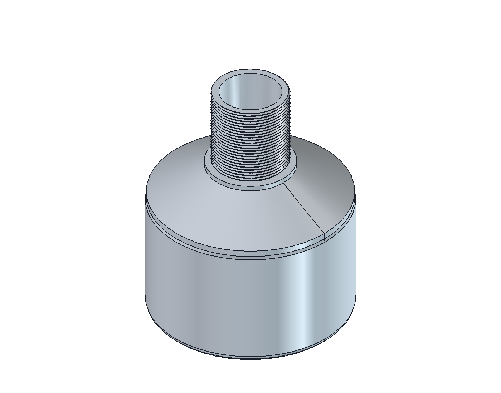
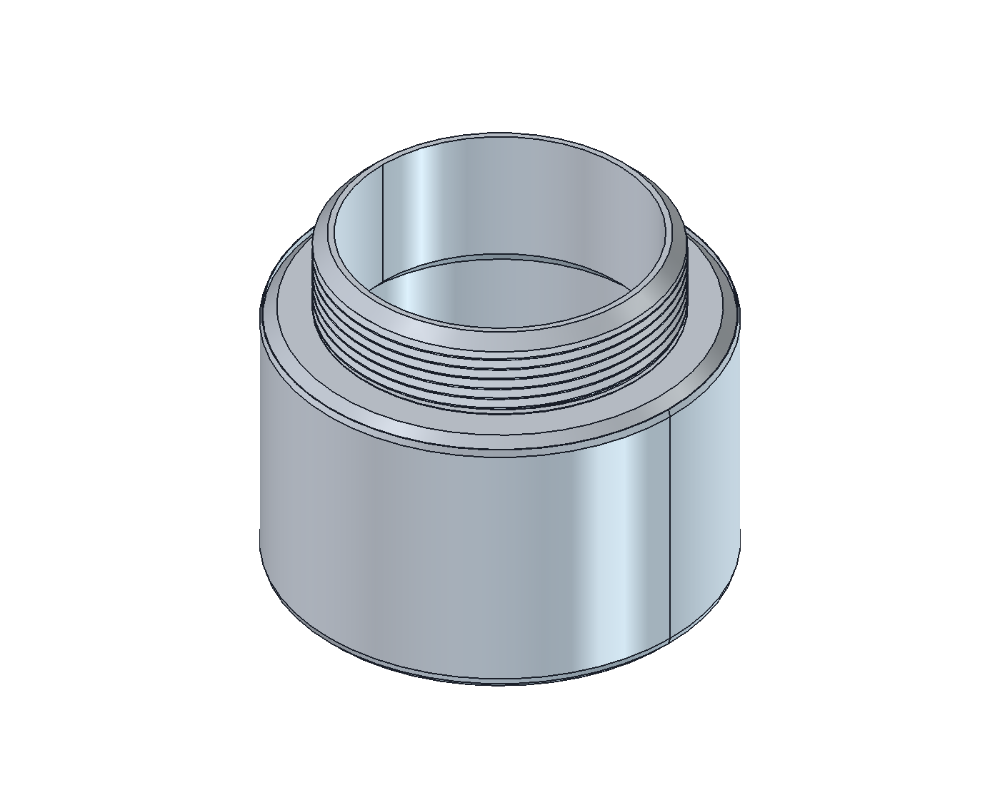
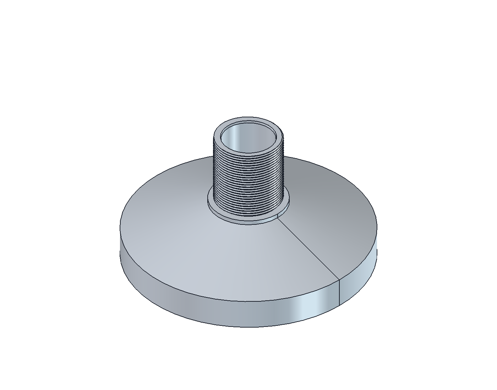
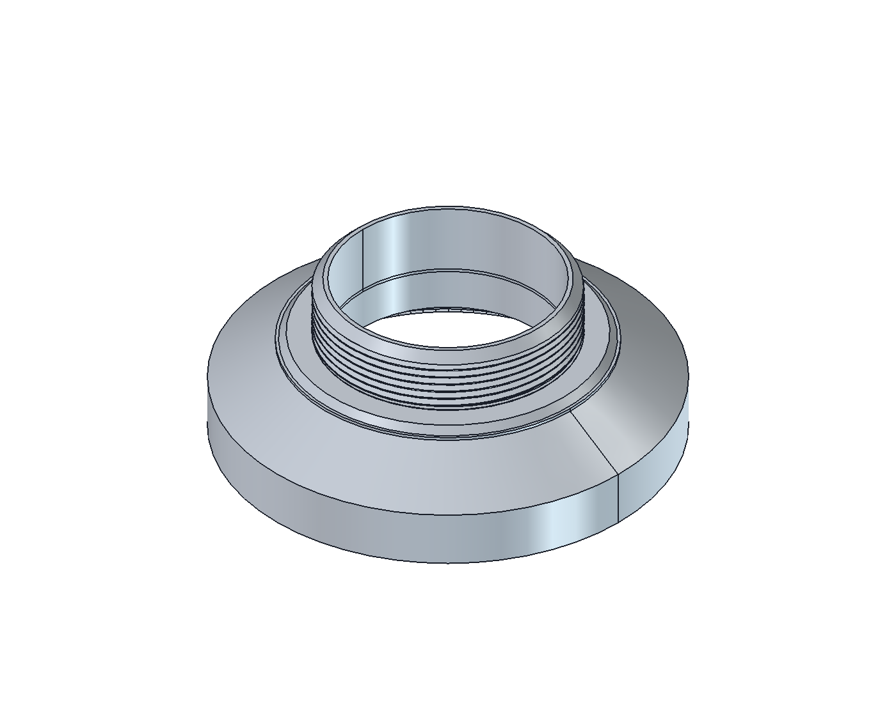
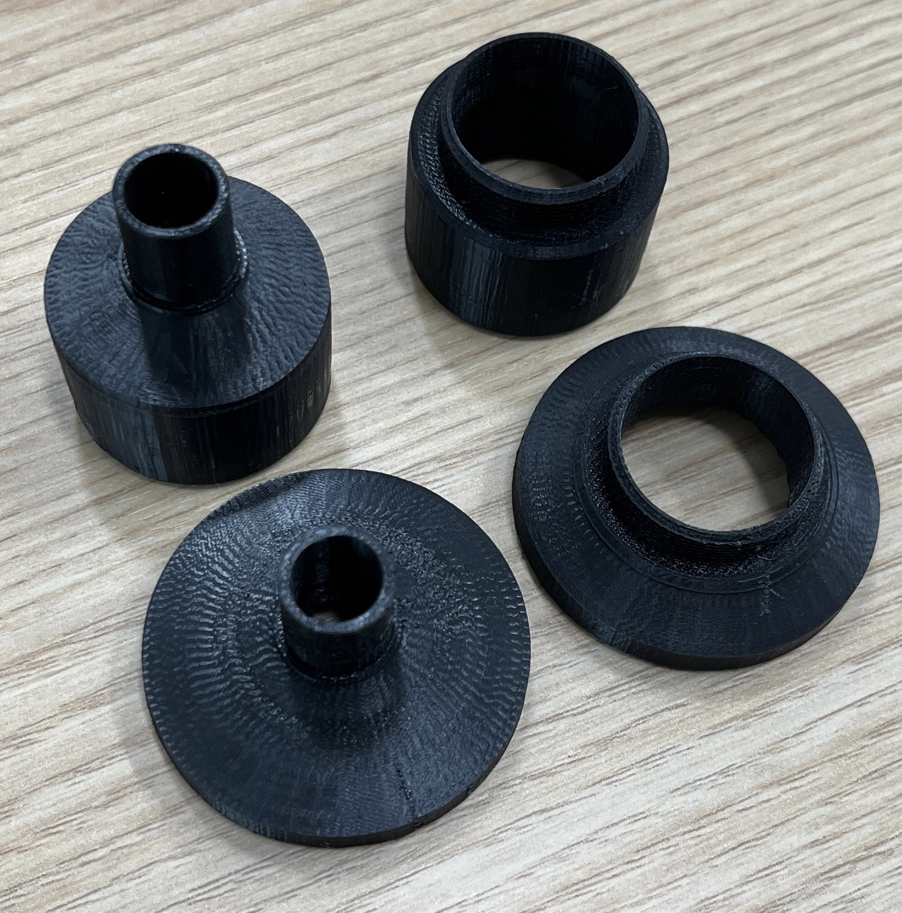
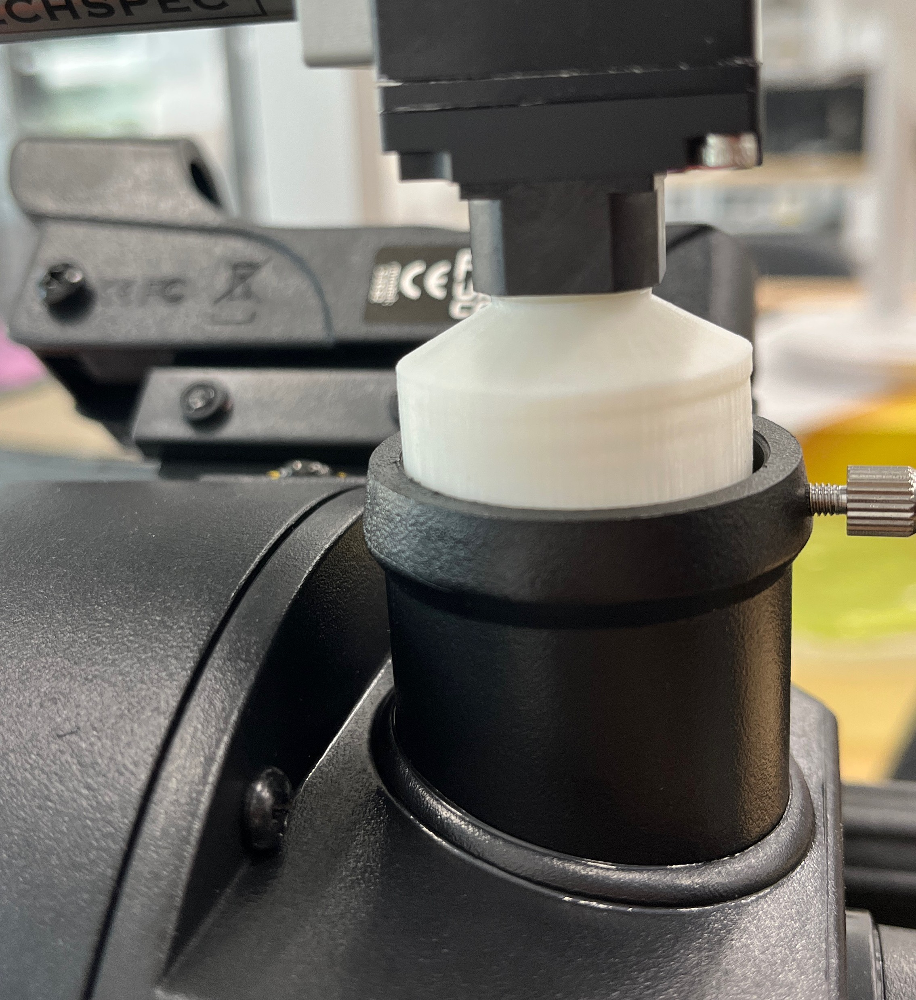
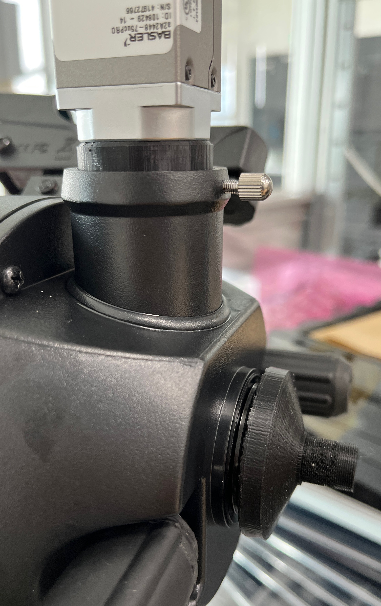

# Celestron Camera Mount Adapters

Four 3D-printable adapters for connecting M12 and C-mount cameras to a Celestron telescope through either a 1.25-inch eyepiece holder or the NexStar 4SE 1-3/8-24 TPI interface.

## Adapter set

| Telescope side | Camera side | FreeCAD | STL |
| --- | --- | --- | --- |
| 1.25-inch nosepiece | M12x0.5 | [`FCStd`](cad/freecad/telescope_1p25_to_m12_adapter_od31p90.FCStd) | [`STL`](models/stl/telescope_1p25_to_m12_adapter_od31p90.stl) |
| 1.25-inch nosepiece | C-mount | [`FCStd`](cad/freecad/telescope_1p25_to_cmount_adapter_od31p90.FCStd) | [`STL`](models/stl/telescope_1p25_to_cmount_adapter_od31p90.stl) |
| NexStar 4SE 1-3/8-24 TPI | M12x0.5 | [`FCStd`](cad/freecad/nexstar4se_1p375_24tpi_female_to_m12_adapter_bore9p45.FCStd) | [`STL`](models/stl/nexstar4se_1p375_24tpi_female_to_m12_adapter_bore9p45.stl) |
| NexStar 4SE 1-3/8-24 TPI | C-mount | [`FCStd`](cad/freecad/nexstar4se_1p375_24tpi_female_to_cmount_adapter.FCStd) | [`STL`](models/stl/nexstar4se_1p375_24tpi_female_to_cmount_adapter.stl) |

A [`four-adapter print plate`](models/stl/telescope_four_adapters_all_latest.stl) is also included. It contains four separate parts arranged for one slicer job.

## FreeCAD renders

| 1.25-inch to M12 | 1.25-inch to C-mount |
| --- | --- |
|  |  |

| 1-3/8-24 TPI to M12 | 1-3/8-24 TPI to C-mount |
| --- | --- |
|  |  |

## Printed adapters

All four adapters printed in black PLA, covering the M12 and C-mount options for both telescope interfaces.

## Physical fit checks

| M12 camera with 1.25-inch adapter | C-mount/1.25-inch and TPI-side adapters installed |
| --- | --- |
|  |  |

## Print settings used

- Material: PLA
- Layer height: 0.05 mm
- Color: black recommended

Black filament is preferred around the optical path because it generally reduces stray reflections and absorbs more light than white or other light-colored prints. A matte black surface or internal baffling can reduce reflections further; glossy black PLA is not an optical-grade absorber.

## Notes

- All CAD and mesh files use millimetres.
- The individual STL files were checked as closed solids.
- The 1.25-inch fit sections use a conservative 31.90 mm outside diameter.
- Verify thread fit, focus reach, camera clearance, and printed strength on your own telescope and camera before use.
- These are practical mechanical reference models, not manufacturer-certified telescope or camera drawings.
